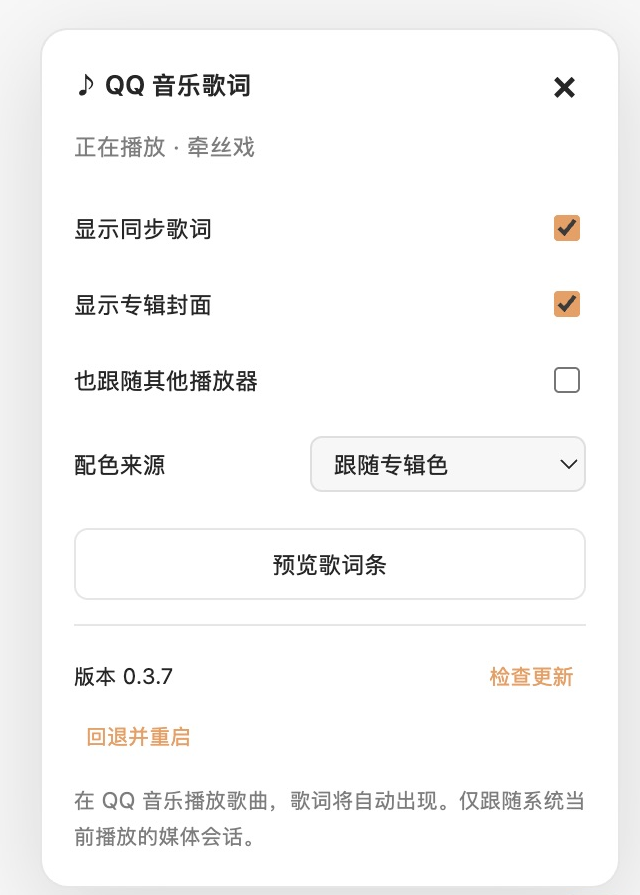
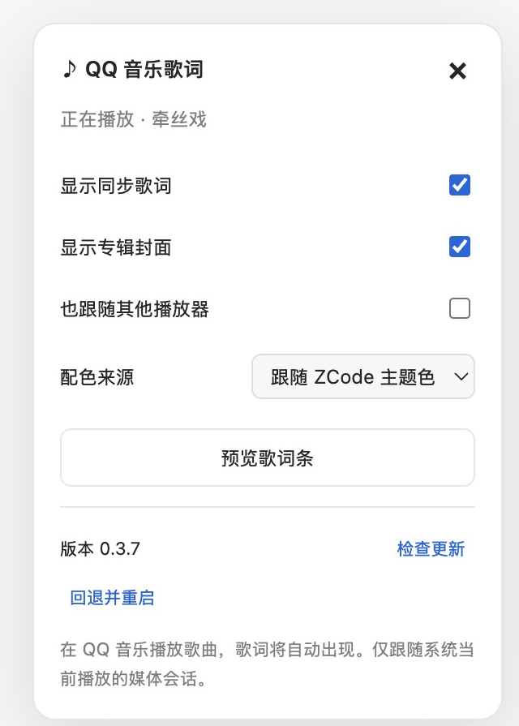

# ZCode QQ 音乐歌词插件

在 ZCode 聊天输入框上方显示 QQ 音乐同步歌词。当前 **0.3.16**，适配官方 **ZCode macOS 3.15.3**。

[下载安装器](https://github.com/Feifive/zcode-qqmusic-plugin/releases/latest) · [安装说明](INSTALL-OTHER-MAC.md)

## 产品截图

以下截图来自 ZCode macOS 3.15.3 中实际运行的插件。

**同步歌词与副歌标记** — 歌词融入聊天输入框上方，小竖标提示副歌起点，配色跟随当前专辑。


**播放控制** — 悬停或键盘聚焦时显示上一首、播放 / 暂停和下一首，进度条支持点击与拖动。


| 跟随专辑色 | 跟随 ZCode 主题色 |
| --- | --- |
|  |  |

**封面预览** — 悬停或聚焦小封面约 2 秒，在上方展开原尺寸封面大图。


## 安装和升级

退出 ZCode，解压并双击 **ZCode Music Installer.app**，点击「安装 / 修复」。支持 Apple Silicon 与 Intel，无需另外安装 Node.js、npm 或编译工具。

首次安装会备份官方原包，在 ZCode 中安装固定加载器。歌词、界面、配色和媒体读取库放在独立目录，之后在歌词设置点击「检查更新 → 更新并重启」即可，**普通插件升级不修改、复制或重新签名 ZCode.app**。升级保留设置与上一版本，可在设置里回退。点击输入框上方最右侧固定的 ♪ 打开歌词设置，歌名仅展示歌曲信息。也可使用安装器检查更新、修复或卸载。

ZCode 官方升级可能覆盖加载器；需要使用适配该官方版本的安装器修复。当前不会尝试修改未经验证的 ZCode 版本。首次安装仍会修改原厂应用签名，安装器与修改后的 ZCode 使用本机临时签名；安装器尚未使用 Apple Developer ID 公证。插件更新签名与 Apple 公证是不同机制。

## 功能

- 设置面板支持 QQ / 微信扫码登录，显示 QQ 音乐昵称、头像与可确认的会员标识，并可退出；凭据通过 Electron `safeStorage` 加密保存，二维码过期可刷新，关闭面板自动取消扫码。上一首左侧的红心可将当前歌曲加入或移出「我喜欢」，成功后维护账号内的收藏集合；失败回滚，未登录时引导扫码。详见 [登录说明](docs/login.md) 与 [收藏说明](docs/favorites.md)。

- 歌名前显示 20×20 圆角专辑封面，缺失或加载失败时显示唱片占位图；主题色与专辑色模式均显示封面，可在设置中关闭封面，悬停约 2 秒显示原尺寸大图。封面缩略图复用同一次缓存请求，不阻塞歌词同步。
- QQ 音乐系统当前播放会话、播放/暂停、上一首/下一首；可选跟随其他播放器。
- 进度条支持点击、拖动定位，松手时提交；暂停时定位成功后自动恢复播放。方向键每次前后 5 秒，Home / End 跳到起点或终点。未知时长和演示模式不发送定位命令。
- 进度条用一个小圆角竖标提示副歌起点，跟随主题色或专辑色。只选置信度最高的一段，同分取最早起点；无有效数据时隐藏，不影响进度拖动。详见 [副歌标记说明](docs/refrain.md)。
- QRC 按真实逐字时间和字符像素宽度推进，高速英文、重叠词和长句滚动使用同一播放时间轴。只有 LRC 时显示逐行歌词。
- 只在对话跟随最底部时显示歌词条，避免与聊天内容重叠。
- 设置可选跟随 ZCode 主题色或专辑色，歌名、数字进度和控制高亮跟随同一配色；进度条未播放部分为灰色。
- 专辑色模式在封面等待、缺失、下载/解码/取色失败或映射失败时，统一回退 QQ 绿 `#00F168`，失败数据不再进入灰度规则。真实灰度封面仍按有效配色映射；主题色模式始终跟随 ZCode。
- 专辑色使用 [配色说明](docs/colors.md) 中的全尺寸解码、10×10 区域平均、封面提取、8 个色相桶、HSB 柔和化及亮/暗各 26 条映射规则实现，无额外对比度重调。包含完整的固定配色表。
- 拆分 QQ 搜索结果的分号歌手字段，用完整版本标题、时长和专辑区分原版、Live、纯音乐和 Remix。回归案例 K/DA《POP/STARS》不会误选 50 秒 Remix。

## 加载与更新设计

```text
ZCode.app 中的固定加载器（首次安装或修复）
                ↓ 验证签名与文件哈希
~/Library/Application Support/ZCode Music/
  active.json                 当前版本 / 上一版本，原子切换
  versions/0.3.16/             主进程、界面、媒体库与签名清单
  settings.json              插件偏好设置
  backups/<官方版本>-<哈希>/   原始官方 ZCode.app
  installation.json          加载器安装记录
```

更新源固定为本仓库的 GitHub Releases。发布包用 **Ed25519** 签名，公钥固定在加载器中；每个文件另外检查 SHA-256 与大小。拒绝路径穿越、未知文件、过大的下载、错误版本、未经适配的 ZCode 和需要更高加载器版本的发布。校验全部成功后才写入版本目录并原子切换。启动时再次校验，当前版本损坏时回退到上一份通过校验的版本。

运行时代码按完整版本存放，无需热替换正在执行的代码；升级重启后生效。加载器只暴露固定音乐/更新 IPC，并核对主窗口与主 frame，不向网页或子 frame 开放。不会接管 ZCode 官方自动更新机制。

## 开发和发布

无 npm 第三方依赖。开发者需要 macOS、Node.js 22+、Xcode Command Line Tools。

```sh
npm test
npm run release          # 编译 universal 媒体库并签名插件发布包
npm run pack:installer   # 生成约百 KB 的 universal 双击安装器
npm run pack:source      # 生成源码包，仅包含当前签名发布包
npm run install:app      # 安装固定加载器或更新外置插件
npm run status
npm run update
npm run rollback
npm run uninstall        # 卸载加载器，恢复匹配原包
```

发布步骤：修改代码和 `package.json` 版本 → 写 `release/notes-<版本>.md` → `npm test` → `npm run release` → 提交源码与 `release/zcode-music-<版本>.json`。推送 main 后 GitHub Actions 自动运行测试、打包安装器，并在全部资产上传后发布 Release。工作流位于 `.github/workflows/`。也可运行 `npm run publish:release`，通过本机已登录的 Git 凭据手动发布。已正式发布的相同版本不会被替换，修正应提升版本号。

签名私钥 `.release-private-key.pem` 仅留在发布者本机，已被 Git 忽略，**不要提交或上传**。可以通过 `ZCODE_MUSIC_SIGNING_KEY_FILE` 指定另一处安全备份。务必备份原私钥；更换公钥需要安装新版加载器。发布工具只使用现有 GitHub 登录凭据，私钥不会上传。GitHub Actions 也只打包已签好的插件，不需要保存发布私钥。

`npm run build -- /绝对路径/ZCode.app` 只用于开发验证固定加载器，必须显式指定未修改的官方应用。普通插件发布不运行这一步。安装器在目标电脑自己生成原包备份和加载器副本，不分发官方 ZCode 应用。

## 验证与限制

`npm test` 覆盖歌词、副歌点解析与选择、歌曲版本匹配、完整配色原表、设置、签名更新、错误包拒绝、版本切换/回退、损坏回退与 IPC 信任边界。`test/refrain.html`、`test/colors.html`、`test/word-sync.html`、`preview.html` 可用于界面预览；`npm run test:live` 检查正在播放的真实 QQ 会话。

媒体桥接通过 macOS MediaRemote 读取系统当前播放会话，macOS 15.4+ 采用系统 Perl 加载本地媒体库，参考 [mediaremote-adapter](https://github.com/ungive/mediaremote-adapter)。无需修改 SIP。当前实测 macOS 27.0.1、QQ 音乐 11.10.5；其它 macOS 版本需要目标机验证。

QQ 音乐必须向系统媒体会话上报歌曲与时间；空会话时无法获取歌曲信息。歌词检索只向 QQ 音乐公开接口发送标题、歌手等匹配信息，封面来自固定 QQ CDN，不读取播放器登录信息。可选扫码登录由主进程独立处理，凭据加密保存且不传给界面。歌词服务可能无结果。进度定位按已知时长提供入口，发送后确认真实播放头是否到位；不支持定位或请求失败时恢复实际进度并提示。详见 [进度定位说明](docs/seek.md)。

本项目为第三方扩展，与 ZCode、QQ 音乐官方无关联。Windows、Linux 与其它 ZCode 版本尚未适配。
